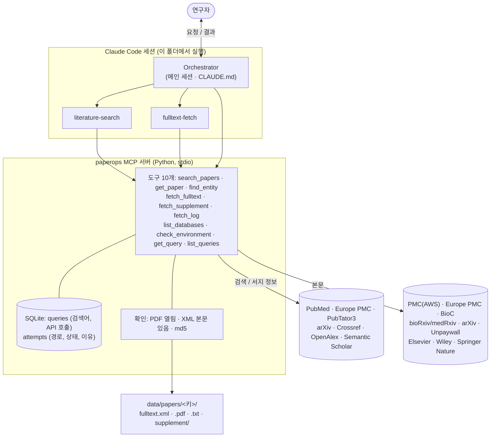

> *사서(司書)는 조선 시대에 왕세자의 교육을 맡던 세자시강원(世子侍講院)에 속한 정6품 벼슬입니다. 오늘날 도서관에서 책을 관리하는 전문직 "사서"라는 말이 여기서 왔습니다. 이 사서는 논문을 찾고, 받고, 어디서 왔는지 기록해 둡니다.*

# 사서(Saseo): 생명정보학 논문 수집 팀

[](https://github.com/Sejung98/Saseo/actions/workflows/tests.yml)
[](LICENSE)

**말로 요청하면, 정해 둔 논문 데이터베이스에서 논문을 찾고, 본문과 보충자료를 받아 제대로 된 파일인지 확인하고, 어떤 검색어를 썼는지와 못 받은 논문은 왜 못 받았는지를 기록합니다.**

[English README](README.md)

논문을 찾아 주는 스킬과 커넥터는 많지만, 저마다 다루는 데이터베이스가 다르고 어디서 가져오는지 잘 밝히지 않습니다. 사서는 생명정보학에서 실제로 쓰는 데이터베이스만 골라 고정하고, 데이터베이스마다 무엇을 주는지(검색, 초록, 본문, 보충자료)와 API 키가 필요한지를 적어 두며, 논문 하나하나가 어디서 왔는지 남깁니다.

## 바로 시작하기

Python 3.10 이상과 [Claude Code](https://code.claude.com/docs)가 있으면 됩니다.

```bash
git clone https://github.com/Sejung98/Saseo.git
cd Saseo && ./install.sh --probe   # .venv 생성, 의존 패키지 설치, 모든 데이터베이스를 한 번씩 호출해 봄
claude                                 # 이 폴더에서 Claude Code 실행 → 폴더 신뢰, paperops MCP 서버 허용
```

그다음 이렇게 요청합니다. *"유방암 APOBEC mutational signature 최근 논문 찾아서, 공개된 것은 본문까지 받아 줘."*

시작하는 데 API 키는 필요 없습니다. PubMed, Europe PMC, PubTator3, PMC, bioRxiv/medRxiv, arXiv, Crossref, OpenAlex, Semantic Scholar는 키 없이 응답합니다. 키는 속도를 올리거나 출판사 본문을 받을 때만 필요합니다(아래 키 표). Claude Code가 없어도 같은 기능을 명령줄로 쓸 수 있습니다([명령줄](#명령줄)).

## 데이터베이스

사서가 **각 데이터베이스에서 실제로 가져오는 것**입니다(그 데이터베이스가 줄 수 있는 전부가 아닙니다).

| 데이터베이스 | 다루는 범위 | 검색 | 초록 | 본문 | 보충자료 | API 키 |
|---|---|---|---|---|---|---|
| **PubMed**<br>`pubmed` | 의생명 학술지 논문(MEDLINE + PMC), MeSH 용어 | 됨(PubMed 문법, 필드 태그, MeSH) | 됨 | 안 됨 | 안 됨 | 선택<br>`NCBI_API_KEY` |
| **Europe PMC**<br>`europepmc` | PubMed + PMC + 프리프린트 + 특허를 한 색인으로 | 됨(본문 검색 포함) | 됨 | 공개(OA) 논문만 JATS XML | 공개 논문만 zip | 필요 없음 |
| **프리프린트 검색**<br>`preprints` | Europe PMC가 색인한 bioRxiv, medRxiv 등 | 됨 | 됨 | `biorxiv`, `arxiv` 참고 | 안 됨 | 필요 없음 |
| **PubTator3**<br>`pubtator` | 유전자·변이·질병·화합물·종이 표시된 PubMed/PMC | 됨(개체 검색, 예: `@GENE_BRCA1 AND @DISEASE_Breast_Neoplasms`) | `pubmed`로 | 안 됨 | 안 됨 | 필요 없음 |
| **PMC 공개 저장소(AWS)**<br>`pmc_s3` | PMC 공개 논문과 저자 원고 | 안 됨 | 안 됨 | JATS XML + PDF + 텍스트, md5 확인 | 됨(파일 단위, md5 확인) | 필요 없음 |
| **PMC BioC API**<br>`pmc_bioc` | PMC 공개 논문과 저자 원고, 문단 단위 JSON | 안 됨 | 안 됨 | 텍스트만(PDF·그림 없음) | 안 됨 | 필요 없음 |
| **bioRxiv / medRxiv**<br>`biorxiv` | 생명과학·의학 프리프린트 | 검색어 검색 없음(DOI·날짜만, 검색은 `preprints`) | 됨 | PDF + JATS XML | 안 됨(웹 페이지에만 있음) | 필요 없음 |
| **arXiv**<br>`arxiv` | q-bio, stat, cs 프리프린트(방법론, 기계학습) | 됨(`all:`, `ti:`, `cat:q-bio.GN`) | 됨 | PDF | 안 됨 | 필요 없음 |
| **Crossref**<br>`crossref` | 거의 모든 출판사의 DOI 서지 정보 | 됨 | 가끔(출판사가 넣었을 때만) | 안 됨(링크만, `publisher` 단계가 씀) | 안 됨 | 필요 없음 |
| **OpenAlex**<br>`openalex` | 모든 분야 학술 문헌, 공개 사본 위치 | 됨 | 됨(대부분) | 공개 PDF가 있으면 그 링크 | 안 됨 | 선택<br>`OPENALEX_API_KEY` |
| **Semantic Scholar**<br>`semanticscholar` | 모든 분야, 인용 관계 | 됨 | 됨(일부 출판사는 막음) | 공개 PDF가 있으면 그 링크 | 안 됨 | 선택<br>`S2_API_KEY` |
| **Unpaywall**<br>`unpaywall` | 어떤 DOI든 합법적 공개 사본 위치 | 안 됨 | 안 됨 | 공개 PDF가 있으면 그 링크 | 안 됨 | 키 대신 이메일 |
| **Elsevier**<br>`elsevier` | Elsevier 학술지(Cell Press, Lancet 등), DOI 10.1016 | 안 됨 | 안 됨 | XML. 기관이 Elsevier에 등록돼 있어야 함(IP 또는 기관 토큰) | 안 됨 | 필수<br>`ELSEVIER_API_KEY`<br>`ELSEVIER_INSTTOKEN` |
| **Wiley TDM**<br>`wiley` | Wiley 학술지, DOI 10.1002·10.1111 | 안 됨 | 안 됨 | PDF. 구독 논문은 기관 구독 필요 | 안 됨 | 필수<br>`WILEY_TDM_TOKEN` |
| **Springer Nature OA**<br>`springer` | Springer·BMC·Nature 계열의 공개 논문, DOI 10.1007·10.1038·10.1186 | 안 됨 | 안 됨 | 공개 논문만 JATS XML | 안 됨 | 필수<br>`SPRINGER_API_KEY` |
| **출판사 사이트(기본 꺼짐)**<br>`publisher` | 지금 쓰는 네트워크가 볼 권한이 있는 논문(기관 IP 구독) | 안 됨 | 안 됨 | 페이지가 알려 주는 PDF | 안 됨 | 필요 없음(IP 구독) |

지원하지 않는 것과 이유: Google Scholar(API가 없고 자동 접근은 약관 위반), Web of Science·Scopus·Embase(유료 색인 API, 본문 없음), Sci-Hub 등(저작권 침해라 처음부터 제외), PMC 밖 출판사 보충자료(공통 API 없음), Science·AACR·OUP·NEJM·LWW 본문(텍스트 마이닝 API가 없고 사이트가 자동 접근에 봇 확인 화면을 냄. 공개 사본이 있으면 PMC·Unpaywall·OpenAlex 경로로는 받아짐).

### API 키

키는 환경변수에서만 읽습니다. 파일에 쓰거나, 화면에 찍거나, 기록에 남기지 않습니다.

| 환경변수 | 용도 | 받는 곳 |
|---|---|---|
| `NCBI_API_KEY` | PubMed/PMC 호출 속도(선택: 초당 3회 → 10회) | https://account.ncbi.nlm.nih.gov/settings/ (무료, 즉시) |
| `OPENALEX_API_KEY` | OpenAlex(선택: 같은 IP가 나눠 쓰는 하루 한도 대신 내 한도) | https://openalex.org/settings/api (무료, 즉시) |
| `S2_API_KEY` | Semantic Scholar(선택이지만 키 없이는 검색이 자주 막힘) | https://www.semanticscholar.org/product/api#api-key-form (무료, 사람이 심사) |
| `ELSEVIER_API_KEY` | Elsevier 본문(필수) | https://dev.elsevier.com/ (키는 무료. 구독 기관과 연결돼 있어야 본문이 나옴) |
| `ELSEVIER_INSTTOKEN` | Elsevier 기관 토큰(IP로 기관 인정이 안 될 때만) | 도서관을 통해 Elsevier에 요청 |
| `WILEY_TDM_TOKEN` | Wiley 본문 PDF(필수) | https://onlinelibrary.wiley.com/library-info/resources/text-and-datamining (Wiley 계정으로 무료 발급) |
| `SPRINGER_API_KEY` | Springer Nature 공개 논문 API(필수) | https://dev.springernature.com/ (무료, 즉시) |

Unpaywall은 키는 없지만 실제 연락용 이메일이 없으면 요청을 거절합니다. `config.yaml`의 `contact_email`이나 환경변수 `PAPEROPS_EMAIL`에 넣습니다.

### 실제로 확인한 것

2026-11-20에 대학 네트워크에서 실제 서비스를 호출해 확인한 결과입니다. "시험 못 함"은 말 그대로입니다. 코드는 있고 가짜 응답으로 단위 시험은 했지만, 쓸 수 있는 키가 없어 실제 성공은 보지 못했습니다.

| 데이터베이스 | 2026-11-20 실제 호출 결과 |
|---|---|
| `pubmed` | 검색, 초록: 됨 |
| `europepmc` | 검색, 본문 XML, 보충자료 zip: 됨. 다만 그날은 느리고 불안정(요청 하나에 최대 47초, 일부는 시간 초과·HTTP 503) |
| `preprints` | 검색: 됨 |
| `pubtator` | 검색, 개체 조회: 됨 |
| `pmc_s3` | XML, PDF, 보충자료: 됨, md5 일치 |
| `pmc_bioc` | 본문: 됨 |
| `biorxiv` | 서지 정보, JATS XML: 됨. PDF: 시험 네트워크에서는 봇 확인(HTTP 403) |
| `arxiv` | 검색, PDF: 됨(그날 한동안은 API가 HTTP 429) |
| `crossref` | 검색, DOI 조회: 됨 |
| `openalex` | 검색, DOI 조회: 키 없이 됨 |
| `semanticscholar` | DOI 조회: 키 없이 됨. 검색: 키 없이는 HTTP 429 |
| `unpaywall` | 이메일 없으면 거절: 확인. 성공 경로: 시험 못 함(이메일 미설정) |
| `elsevier` | 기관과 연결 안 된 키: 공개 논문조차 HTTP 403(`not_entitled`). 성공 경로: 시험 못 함 |
| `wiley` | 시험 못 함(토큰 없음). 토큰 없이는 HTTP 400 |
| `springer` | 키 없으면 HTTP 401: 확인. 성공 경로: 시험 못 함(키 없음) |
| `publisher` | 구독 대학 네트워크에서 Nature, Genome Research PDF: 됨. Science는 봇 확인 화면(기록만 하고 우회하지 않음) |

`check_environment(probe=True)`(또는 `./install.sh --probe`)를 돌리면 내 컴퓨터에서 같은 점검을 1분쯤에 다시 하고, *키가 필요함*, *키가 거절됨*, *권한 없음*, *서비스가 바쁨*을 구분해 알려 줍니다.

## 요청 예시

2026-11-20 실제 실행 결과를 줄인 것입니다(API 키 없음).

```
나:    2023년 이후 유방암 mutational signature 논문 찾아 줘.
사서:  literature-search → search_papers(sources=[pubmed, pubtator, crossref, openalex, semanticscholar], year_from=2023)
       pubmed           됨    801건    보낸 검색어: "mutational signature breast cancer"
                                       PubMed 해석: ("mutate"[All Fields] OR ... "mutation"[MeSH Terms] ...) AND ...
       pubtator         됨    49,524건
       crossref         됨    946,061건
       openalex         됨    79,863건
       semanticscholar  실패  rate_limited: 키 없는 요청은 전 세계가 한도를 나눠 씀 → S2_API_KEY 설정
       → 겹치는 것을 합쳐 16편(DOI / PMID 기준), query_id se_20261120061243_cc32df, 1곳 실패라 일부 결과

나:    PMID 32025018 본문이랑 보충자료 받아 줘.
사서:  fulltext-fetch → fetch_fulltext("32025018", want_pdf=True)
       pmc_s3  됨   fulltext.xml(712,515바이트) + fulltext.pdf(7,069,239바이트, 28쪽), md5 일치,
                    첫 쪽들에서 제목 확인 → fulltext.txt(43,416자)
       fetch_supplement → 보충 PDF 4개, md5 일치

나:    10.1016/j.cell.2023.01.035 도.
사서:  못 받았습니다. 시도한 곳과 이유:
       pmc_s3 / europepmc / pmc_bioc   건너뜀  not_applicable   PMCID가 없는 논문
       unpaywall                       건너뜀  no_email         contact_email 설정 필요
       openalex                        실패    bot_wall         "공개" PDF 링크가 봇 확인 화면을 돌려줌
       semanticscholar                 실패    paywall          파일 대신 웹 페이지가 옴
       elsevier                        건너뜀  no_key           ELSEVIER_API_KEY 미설정
       publisher                       건너뜀  disabled         allow_publisher_direct 가 false
       다음 할 일: ELSEVIER_API_KEY 설정, contact_email 설정, 또는 https://doi.org/10.1016/j.cell.2023.01.035 를 브라우저로
```

언어 모델은 계획을 세우고 인자만 고릅니다. 제목, 식별자, 초록은 모두 API 응답에서 오고, 파일은 열어서 확인한 뒤에만 받은 것으로 칩니다.

## 기록: 검색어와 실패 이유

호출할 때마다 두 가지를 로컬 SQLite 파일(`state/paperops.sqlite`)에 남기고, 결과에도 함께 돌려줍니다.

**1. 어떤 검색어를 어디에 보냈는지.** 데이터베이스마다 보낸 검색 문자열, 그쪽이 알려 준 결과 수, 그리고 PubMed가 검색어를 어떻게 해석했는지를 저장합니다. 마지막 것이 중요합니다. 실제 시험에서 `Alexandrov repertoire of mutational signatures in human cancer` 라는 자유 검색어는 PubMed 결과가 0건이었는데, 기록을 보니 PubMed가 `human in` 을 저자 이름(`human, in[Author]`)으로 읽었습니다. 필드 태그를 붙인 `repertoire mutational signatures human cancer[ti]` 로는 그 논문이 나왔습니다.

**2. 논문을 왜 못 받았는지.** 시도한 곳마다 `ok`(됨), `skip`(건너뜀), `fail`(실패) 가운데 하나와 이유 코드가 남습니다.

| 이유 코드 | 뜻 | 해결 방법 |
|---|---|---|
| `not_applicable` | 그 경로가 이 논문을 다루지 않음(PMCID 없음, 다른 출판사 DOI) | 없음. 정상 |
| `no_key`, `no_email` | 키나 연락 이메일이 설정 안 됨 | 설명에 나온 환경변수를 설정 |
| `key_rejected` | 키가 틀렸거나, 만료됐거나, 아직 활성화 전(HTTP 401/403) | 발급처에서 키 확인 |
| `not_entitled` | 키는 맞지만 기관에 이 논문을 볼 권한이 없음 | 도서관에 기관 토큰·구독 문의 |
| `not_open_access` | 논문은 알지만 무료 사본이 없음 | 구독 경로나 직접 내려받기 |
| `paywall` | 파일 대신 로그인·안내 페이지가 옴 | 위와 같음 |
| `bot_wall` | CAPTCHA·Cloudflare 확인 화면이 옴. 우회하지 않음 | 브라우저로 직접 내려받기 |
| `rate_limited` | 요청이 너무 많음(HTTP 429) | 기다리거나 그 데이터베이스 키 설정 |
| `timeout`, `server_error`, `network_error` | 서비스가 느리거나 죽었거나 연결 안 됨 | 나중에 다시. 키 문제가 아님 |
| `abstract_only` | 본문 없이 초록만 옴 | 다른 경로 |
| `invalid_file` | 받은 것이 읽을 수 없는 PDF/XML이거나 md5가 다름 | 다시 시도. 파일은 지움 |
| `too_large`, `blocked_url`, `disabled`, `no_supplement`, `not_supported`, `internal_error` | 크기 제한, 안전상 거부, 꺼 둔 단계, 받을 것이 없음, 버그 | 설명 문구 참고 |

*"그 논문 왜 안 받아졌어?"*, *"오늘 실패한 것 뭐야?"* 라고 물으면 Orchestrator가 `fetch_log`로 읽어 줍니다. 명령줄에서는 `paperops log --status fail`.

## 본문을 받는 순서

논문을 한 편씩, 아래 순서로 시도하고, 확인을 통과한 파일이 나오면 멈춥니다.

```
pmc_s3 → europepmc → pmc_bioc → biorxiv → arxiv → unpaywall → openalex → semanticscholar
       → elsevier → wiley → springer → publisher(기본 꺼짐)
```

파일은 다음 확인을 통과해야 받은 것으로 칩니다.

- **PDF**: `%PDF`로 시작하고, pypdf로 열리고, 쪽이 있어야 합니다. 글자를 뽑아 첫 두 쪽에 논문 제목이 있는지 봅니다(`title_match`). 로그인 페이지가 `.pdf` 이름으로 저장된 경우는 성공이 아니라 `paywall`로 기록합니다.
- **XML**: JATS로 읽히고, 초록만이 아니라 본문이 들어 있어야 합니다.
- **PMC 파일**: PMC가 공개한 md5와 비교합니다.

저장 위치: `data/papers/<논문 키>/` 아래 `fulltext.xml`, `fulltext.pdf`, `fulltext.txt`(읽기용 텍스트. XML이 있으면 XML에서 만듦), `metadata.json`, `supplement/`.

보충자료는 PubMed Central에서만 받습니다(`pmc_s3`, 그다음 `europepmc`). PMC 공개 목록에 없는 논문이면 그렇다고 알리고 출판사 링크를 줍니다.

## 구조



### 안전 원칙

| 원칙 | 지키는 방법 |
|---|---|
| 역할 분리 | 하위 에이전트의 `tools` 목록에는 자기 MCP 도구만 있습니다. 검색 에이전트는 내려받지 못하고, 받기 에이전트는 검색어 검색을 못 합니다. |
| 근거 있는 답 | 모든 결과에 `query_id`와 실제 API 호출 목록(`api_queries`)이 붙습니다. 에이전트는 제목·식별자·초록을 도구 결과에서만 말합니다. |
| 키는 밖에 | 키는 호출할 때 환경변수에서 읽습니다. `api_key`, `email` 같은 값은 기록 전에 가리고, 요청 헤더는 기록하지 않으며, 오류 문구에 섞여 나오는 키 값과 연락 이메일도 가립니다. 이메일은 NCBI·Crossref·Unpaywall에만 보냅니다. `config.yaml`은 git에 올라가지 않고 키를 담지 않습니다. |
| 접근 제한 우회 안 함 | 로그인 페이지와 봇 확인 화면은 `paywall` / `bot_wall`로 기록만 합니다. 넘어가려 하지 않고, 비공식 미러는 쓰지 않습니다. |
| 예의 있는 사용 | 서버별 요청 간격(NCBI 초당 3회, 키가 있으면 10회. arXiv 3초에 1회), 간격을 늘리는 재시도, 누구인지 밝히는 User-Agent, 한 번에 논문 한 편. |
| 안전한 내려받기 | 공개 `http(s)` 주소만 허용합니다. 사설·로컬 주소는 리다이렉트 단계마다 거부하고, 이름이 그런 주소로 풀리는 경우도 거부합니다. 리다이렉트가 API 자체 도메인을 벗어나면 키 헤더를 뗍니다. 파일 크기 제한, 파일 이름 정리, zip 안의 경로는 버리고 이름만 사용. |

## 설정

모든 값에 기본값이 있어서 `config.yaml`은 없어도 됩니다. `install.sh`가 `config.example.yaml`을 `config.yaml`로 복사합니다.

| 키 | 뜻 | 기본값 |
|---|---|---|
| `data_root` | 논문과 검색 결과를 쓰는 곳 | `./data` |
| `state_dir` | SQLite 기록 위치(NFS/Lustre보다 로컬 디스크가 안전) | `./state` |
| `contact_email` | NCBI·Crossref·Unpaywall에 보내는 연락 주소(Unpaywall은 필수) | 비어 있음 |
| `allow_publisher_direct` | 마지막 단계: DOI를 따라 출판사 페이지로 가서 거기 적힌 PDF를 받음. IP로 구독이 인정되는 네트워크에서만 됨 | `false` |
| `max_download_mb`, `max_supplement_files` | 파일 하나, 논문 하나의 한도 | 200, 50 |
| `http.timeout`, `http.retries` | 요청 하나의 제한 시간(초), 429·5xx·네트워크 오류 때 추가 시도 횟수 | 60, 2 |

`PAPEROPS_CONFIG=/경로/config.yaml`로 설정 파일을 저장소 밖에 둘 수 있습니다.

**`allow_publisher_direct`에 대해.** 캠퍼스에서 브라우저로 볼 수 있는 것을 같은 방식으로 읽는 기능입니다. 다만 출판사 계약은 자동·대량 내려받기를 제한하는 경우가 많아 기본은 꺼 두었습니다. 논문 몇 편을 받을 때만 켜고, 대량 수집에는 쓰지 말고, 도서관 약관을 확인하세요.

## 명령줄

MCP 도구는 그대로 명령으로도 쓸 수 있습니다. 시험할 때나 다른 에이전트 틀에서 쓸 때 편합니다.

```bash
.venv/bin/python -m paperops_mcp.cli check --probe                      # 여기서 어떤 데이터베이스가 되는지
.venv/bin/python -m paperops_mcp.cli search "APOBEC mutational signature" --sources pubmed preprints -n 10 --year-from 2024
.venv/bin/python -m paperops_mcp.cli entity "BRAF V600E"                # PubTator3 개체 ID
.venv/bin/python -m paperops_mcp.cli paper 10.1038/s41586-020-1943-3    # 식별자 + 초록
.venv/bin/python -m paperops_mcp.cli fetch 32025018 --pdf               # 본문(+ PDF)
.venv/bin/python -m paperops_mcp.cli supplement PMC7054213
.venv/bin/python -m paperops_mcp.cli log --status fail                  # 왜 실패했는지
.venv/bin/python -m paperops_mcp.cli databases --markdown               # 영문 README의 표
```

### Windows

`install.sh`와 `.mcp.json`은 Linux·macOS 기준입니다. Windows에서는:

```powershell
python -m venv .venv; .venv\Scripts\python -m pip install -e ".[test]"
.venv\Scripts\python -m paperops_mcp.cli check --probe
```

그리고 `.mcp.json`의 `command`를 `${CLAUDE_PROJECT_DIR:-.}/.venv/Scripts/python.exe`로 바꿉니다.

## 시험

```bash
.venv/bin/python -m pytest -q            # 단위 시험. HTTP 호출은 모두 가짜 응답(respx)
.venv/bin/python -m pytest -m live -s    # 실제 API 대상 시험(인터넷 필요)
```

단위 시험은 푸시할 때마다 돕니다(Linux Python 3.10·3.12, Windows 3.12). 식별자 읽기, 기록에서 비밀 값 가리기, HTTP 실패를 이유 코드로 바꾸기, PDF/XML 확인(PDF 이름으로 저장된 로그인 페이지, md5 불일치 포함), 공개 논문과 유료 논문의 받기 순서 전체, 보충자료 zip의 경로 조작 막기, 검색 결과 합치기를 다룹니다. 2026-11-20에 실제 API 시험 4개가 통과했습니다.

## 한계

- **구독 논문은 볼 길이 있어야 받습니다.** 기관과 연결된 출판사 키, 또는 구독 네트워크에서 켠 `allow_publisher_direct`가 그 길입니다. 사서는 어느 쪽이 필요한지 알려 줄 뿐, 권한을 만들어 주지는 못합니다.
- Elsevier, Wiley, Springer Nature, Unpaywall 단계의 **성공 경로는 실제로 시험하지 못했습니다**(쓸 수 있는 키·이메일이 없었음). 거절되는 경우만 확인했습니다. 성공 경로는 공개 API 문서를 보고 만든 가짜 응답으로 단위 시험했습니다.
- 보충자료는 PubMed Central 공개 목록에 있는 논문만 됩니다.
- Europe PMC는 바쁠 때 요청 하나에 수십 초가 걸리거나 HTTP 503을 냅니다. 그래서 PMC 공개 저장소(AWS)를 먼저 시도합니다.
- bioRxiv/medRxiv 파일과 많은 출판사 사이트는 봇 확인 뒤에 있습니다. 네트워크에 따라 JATS XML만 받아지거나 아무것도 안 받아집니다. 기록만 하고 우회하지 않습니다.
- PDF에서 뽑은 글자(pypdf)는 읽고 찾는 데는 충분하지만 표와 수식은 모양이 깨집니다. `fulltext.xml`이 있으면 그것을 쓰세요.
- 검색 순위는 각 데이터베이스가 매긴 것입니다. 합칠 때 여러 곳에서 나온 논문을 앞에 둘 뿐, 뜻을 보고 다시 순위를 매기지는 않습니다.
- 표는 확인한 날의 API 기준입니다. 서비스는 바뀝니다(예전 PMC OA 웹 서비스는 이제 응답하지 않음). 이상하면 `check --probe`부터 돌려 보세요.

## 라이선스

MIT. [LICENSE](LICENSE) 참고. 변경 내역은 [CHANGELOG.md](CHANGELOG.md). 공개 유전체 데이터를 실어 나르는 자매 프로젝트 [Jige(지게)](https://github.com/Sejung98/Jige)를 본떠 만들었습니다.
