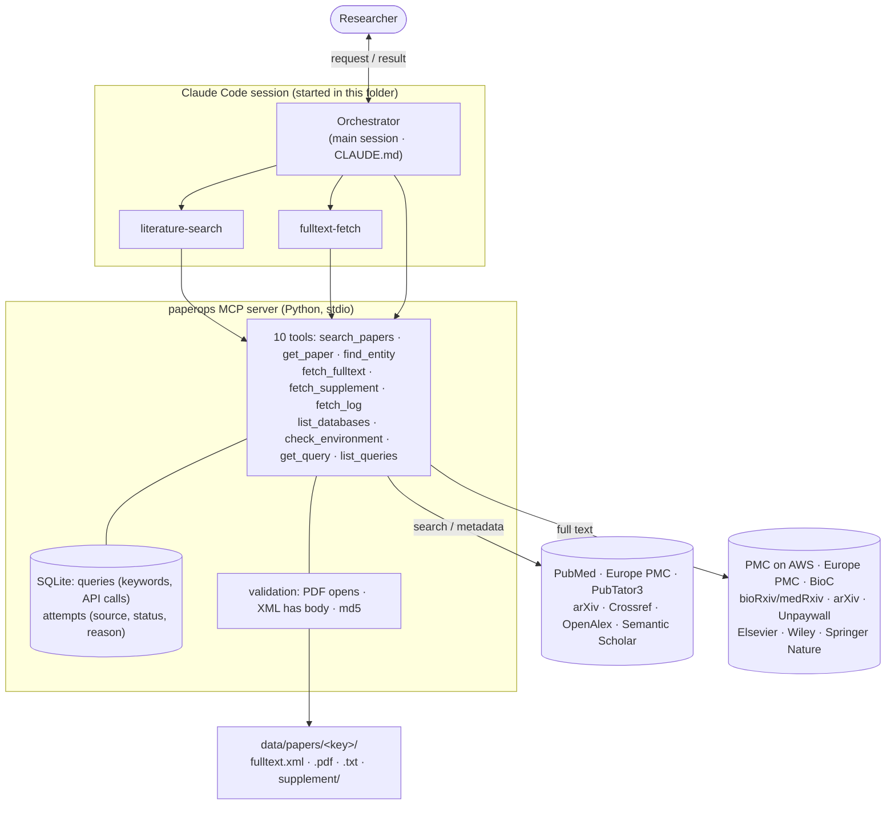

> *Chaekkwae (책쾌) was the travelling book broker of Joseon Korea: he knew which house held which book and brought the right one to the scholar who asked. This one does it for papers.*

# Chaekkwae: Literature Team for Bioinformatics

[](https://github.com/Sejung98/Chaekkwae/actions/workflows/tests.yml)
[](LICENSE)

**Ask in plain language. Chaekkwae searches a fixed, documented set of literature databases, downloads and validates the full text and supplementary files, and logs the keywords it used and the reason for every paper it could not get.**

[한국어 README](README.ko.md)

There are many literature skills and connectors, but each covers a different set of databases and rarely says which. Chaekkwae fixes the set to the ones bioinformatics work actually uses, states for each one what it gives (search, abstract, full text, supplement) and whether it needs an API key, and records where every paper came from.

## Quick start

With Python ≥ 3.10 and [Claude Code](https://code.claude.com/docs) (Claude subscription or API key):

```bash
git clone https://github.com/Sejung98/Chaekkwae.git
cd Chaekkwae && ./install.sh --probe   # creates .venv, installs deps, then calls every database once
claude                                 # start Claude Code in this folder; trust it and allow the paperops MCP server
```

Then ask, for example: *"Find recent papers on APOBEC mutational signatures in breast cancer and get the full text of the open-access ones."*

No API key is needed to start: PubMed, Europe PMC, PubTator3, PMC, bioRxiv/medRxiv, arXiv, Crossref, OpenAlex and Semantic Scholar answer without one. Keys only add speed or publisher full text (see the key table below). No Claude Code? The same functions run from the command line (see [Command line](#command-line)).

## Databases

What Chaekkwae gets **from each database** (not everything the database could offer):

| Database | Covers | Search | Abstract | Full text | Supplement | API key |
|---|---|---|---|---|---|---|
| **PubMed (NCBI E-utilities)**<br>`pubmed` | biomedical journal articles (MEDLINE + PMC), with MeSH terms | yes (PubMed query syntax, field tags, MeSH) | yes | no | no | optional<br>`NCBI_API_KEY` |
| **Europe PMC**<br>`europepmc` | PubMed + PMC + preprints (bioRxiv, medRxiv, Research Square, ...) + patents, in one index | yes (full-text search too) | yes | JATS XML for the open-access subset only | zip, open-access subset only | none |
| **Preprint keyword search (Europe PMC SRC:PPR)**<br>`preprints` | bioRxiv, medRxiv and other preprint servers indexed by Europe PMC | yes | yes | see biorxiv / arxiv | no | none |
| **PubTator3 (NCBI)**<br>`pubtator` | PubMed/PMC with gene, variant, disease, chemical, species and cell-line annotations | yes (entity search, e.g. @GENE_BRCA1 AND @DISEASE_Breast_Neoplasms) | via pubmed | no (use pmc_bioc) | no | none |
| **PMC Open Access on AWS (pmc-oa-opendata)**<br>`pmc_s3` | PMC open-access articles and author manuscripts | no | no (use pubmed) | JATS XML + PDF + plain text, with md5 | yes (individual files, with md5) | none |
| **PMC BioC API (NCBI)**<br>`pmc_bioc` | PMC open-access subset and author manuscripts, as passage-level JSON | no | no (use pubmed) | text only (no PDF, no figures) | no | none |
| **bioRxiv / medRxiv**<br>`biorxiv` | life-science and medical preprints | no keyword search (by DOI or date only; use `preprints`) | yes | PDF + JATS XML | no (web page only) | none |
| **arXiv**<br>`arxiv` | preprints in q-bio, stat, cs (methods, machine learning for biology) | yes (field prefixes: all:, ti:, abs:, cat:q-bio.GN) | yes | PDF | no | none |
| **Crossref**<br>`crossref` | DOI metadata for almost every publisher | yes (bibliographic) | sometimes (only if the publisher deposited it) | no (only links, used by the `publisher` step) | no | none |
| **OpenAlex**<br>`openalex` | all scholarly works, with open-access locations | yes | yes (most works) | link to an open-access PDF when one exists | no | optional<br>`OPENALEX_API_KEY` |
| **Semantic Scholar**<br>`semanticscholar` | all fields; citation graph | yes | yes (some publishers withhold it) | link to an open-access PDF when one exists | no | optional<br>`S2_API_KEY` |
| **Unpaywall**<br>`unpaywall` | legal open-access copies of any DOI (publisher, PMC, repositories) | no | no | link to an open-access PDF when one exists | no | e-mail |
| **Elsevier (ScienceDirect Article API)**<br>`elsevier` | Elsevier journals (Cell Press, Lancet, ...): DOI prefix 10.1016 | no | no | XML; only if your institution is recognised by Elsevier (IP or institutional token) | no | required<br>`ELSEVIER_API_KEY`<br>`ELSEVIER_INSTTOKEN` |
| **Wiley TDM API**<br>`wiley` | Wiley journals: DOI prefixes 10.1002, 10.1111 | no | no | PDF; subscribed content needs an institutional subscription | no | required<br>`WILEY_TDM_TOKEN` |
| **Springer Nature Open Access API**<br>`springer` | open-access articles of Springer, BMC and Nature Portfolio: DOI prefixes 10.1007, 10.1038, 10.1186 | no | no | JATS XML, open-access articles only | no | required<br>`SPRINGER_API_KEY` |
| **Publisher site through the DOI (off by default)**<br>`publisher` | whatever your network is entitled to read (institutional subscription by IP) | no | no | PDF named by the page (citation_pdf_url) or by Crossref links | no | none (subscription by IP) |

Not supported, and why: Google Scholar (no API; automated access is against its terms), Web of Science / Scopus / Embase (paid index APIs, no full text), Sci-Hub and similar (excluded by design), publisher-hosted supplementary files outside PMC (no common API), full text of Science, AACR, OUP, NEJM and LWW journals (no text-mining API, and their sites answer scripts with a bot check; open copies are still found through PMC, Unpaywall and OpenAlex).

### API keys

Keys are read from environment variables only. They are never written to a file, printed, or stored in the log.

| Environment variable | Used for | Where to get it |
|---|---|---|
| `NCBI_API_KEY` | PubMed / PMC E-utilities (optional: 10 requests/s instead of 3) | https://account.ncbi.nlm.nih.gov/settings/ (free, instant) |
| `OPENALEX_API_KEY` | OpenAlex (optional: own daily budget instead of one shared per IP) | https://openalex.org/settings/api (free, instant) |
| `S2_API_KEY` | Semantic Scholar (optional, but keyword search is usually rate-limited without it) | https://www.semanticscholar.org/product/api#api-key-form (free, reviewed by hand) |
| `ELSEVIER_API_KEY` | Elsevier / ScienceDirect full text (required) | https://dev.elsevier.com/ (free key; it must also be linked to a subscribing institution, by IP or by ELSEVIER_INSTTOKEN from your library) |
| `ELSEVIER_INSTTOKEN` | Elsevier institutional token (only if your IP is not recognised) | ask your library to request it from Elsevier |
| `WILEY_TDM_TOKEN` | Wiley Online Library full-text PDFs (required) | https://onlinelibrary.wiley.com/library-info/resources/text-and-datamining (free with a Wiley account; subscribed content needs an institutional subscription) |
| `SPRINGER_API_KEY` | Springer Nature Open Access API (required) | https://dev.springernature.com/ (free, instant) |

Unpaywall needs no key but refuses requests without a real contact e-mail: set `contact_email` in `config.yaml` or the `PAPEROPS_EMAIL` environment variable.

### What was actually tested

Every row was run against the live service from a university network. "Not tested" means exactly that: the code path exists and is unit-tested with mocked responses, but no working key was available.

| Database | Result of the live check on 2026-11-20 |
|---|---|
| `pubmed` | search, abstract: OK |
| `europepmc` | search, full-text XML, supplement zip: OK, but slow and unstable that day (single requests took up to 47 s; some timed out or returned HTTP 503) |
| `preprints` | search: OK |
| `pubtator` | search, entity lookup: OK |
| `pmc_s3` | XML, PDF, supplement files: OK, md5 verified |
| `pmc_bioc` | full text: OK |
| `biorxiv` | metadata, JATS XML: OK. PDF: bot check (HTTP 403) from the test network |
| `arxiv` | search, PDF: OK (the API answered HTTP 429 for part of the day) |
| `crossref` | search, DOI lookup: OK |
| `openalex` | search, DOI lookup: OK without a key |
| `semanticscholar` | DOI lookup: OK without a key. Keyword search: HTTP 429 without a key |
| `unpaywall` | refusal without a real e-mail: confirmed. Success path: not tested (no e-mail configured) |
| `elsevier` | a key not linked to an institution: refused with HTTP 403 (not_entitled), even for an open-access article. Success path: not tested |
| `wiley` | not tested (no token); without a token the API answers HTTP 400 |
| `springer` | HTTP 401 without a key: confirmed. Success path: not tested (no key) |
| `publisher` | from a subscribing campus network: Nature and Genome Research PDFs OK; Science answered with a bot check (logged, not bypassed) |

`check_environment(probe=True)` (or `./install.sh --probe`) repeats this check from your own machine in about a minute and tells apart *needs a key*, *key refused*, *not entitled* and *service busy*.

## What a request looks like

Abridged from real runs on 2026-11-20 (no API keys set).

```
You:        Papers on mutational signatures in breast cancer since 2023.
Chaekkwae:  literature-search -> search_papers(sources=[pubmed, pubtator, crossref, openalex, semanticscholar], year_from=2023)
            pubmed           ok    801 hits   query_sent: "mutational signature breast cancer"
                                              interpreted_as: ("mutate"[All Fields] OR ... "mutation"[MeSH Terms] ...) AND ...
            pubtator         ok    49,524 hits
            crossref         ok    946,061 hits
            openalex         ok    79,863 hits
            semanticscholar  FAIL  rate_limited: keyless requests share one global pool; set S2_API_KEY
            -> 16 unique papers (merged by DOI / PMID), query_id se_20261120061243_cc32df, partial: 1 source failed

You:        Get the full text and supplement of PMID 32025018.
Chaekkwae:  fulltext-fetch -> fetch_fulltext("32025018", want_pdf=True)
            pmc_s3  ok   fulltext.xml (712,515 bytes) + fulltext.pdf (7,069,239 bytes, 28 pages), md5 verified,
                         title found on the first pages -> fulltext.txt (43,416 characters)
            fetch_supplement -> 4 supplementary PDFs, md5 verified

You:        And 10.1016/j.cell.2023.01.035?
Chaekkwae:  NOT fetched. What was tried:
            pmc_s3 / europepmc / pmc_bioc   skip  not_applicable   the paper has no PMCID
            unpaywall                       skip  no_email         set contact_email
            openalex                        fail  bot_wall         the "open" PDF link answered with a bot check
            semanticscholar                 fail  paywall          got a web page instead of the file
            elsevier                        skip  no_key           ELSEVIER_API_KEY is not set
            publisher                       skip  disabled         allow_publisher_direct is false
            next steps: set ELSEVIER_API_KEY; set contact_email; or open https://doi.org/10.1016/j.cell.2023.01.035
```

The language model only plans and picks parameters. Every title, identifier and abstract comes from an API response, and a file counts only after it has been opened and checked.

## The log: keywords and reasons

Two things are recorded for every call, in a local SQLite file (`state/paperops.sqlite`), and returned with every result:

**1. Which keywords went where.** Each search stores the query string sent to each database, the number of hits it reported, and PubMed's own interpretation of the keywords. That last one matters. In the live test, the free-text query `Alexandrov repertoire of mutational signatures in human cancer` returned 0 PubMed hits, and the log showed why: PubMed had read `human in` as an author (`human, in[Author]`). The field-tagged query `repertoire mutational signatures human cancer[ti]` found the paper.

**2. Why a paper was not fetched.** Each source that was tried ends as `ok`, `skip` or `fail` with one reason code:

| Reason | Meaning | What helps |
|---|---|---|
| `not_applicable` | The source does not handle this paper (no PMCID, another publisher's DOI) | Nothing; expected |
| `no_key`, `no_email` | A key or contact e-mail is not set | Set the environment variable named in the detail |
| `key_rejected` | The key is wrong, expired or not activated (HTTP 401/403) | Check the key at the provider |
| `not_entitled` | The key is valid but the institution has no right to this article | Library: institutional token or subscription |
| `not_open_access` | The source knows the paper but lists no free copy | Subscription route, or manual download |
| `paywall` | A login or landing page came back instead of the file | Same |
| `bot_wall` | A CAPTCHA / Cloudflare check came back. Never bypassed | Manual download in a browser |
| `rate_limited` | HTTP 429 | Wait, or set that source's key |
| `timeout`, `server_error`, `network_error` | The service was slow, down or unreachable | Retry later; not a key problem |
| `abstract_only` | The record came back without the article body | Another source |
| `invalid_file` | The download is not a readable PDF/XML, or its md5 does not match | Retry; file is deleted |
| `too_large`, `blocked_url`, `disabled`, `no_supplement`, `not_supported`, `internal_error` | Limits, safety refusals, switched-off steps, nothing to fetch, a bug | See the detail text |

Ask *"why didn't that paper download?"* or *"what failed today?"* and the Orchestrator reads it back with `fetch_log`. From the shell: `paperops log --status fail`.

## How full text is fetched

One paper at a time, sources in this order, stopping at the first that delivers a validated file:

```
pmc_s3 -> europepmc -> pmc_bioc -> biorxiv -> arxiv -> unpaywall -> openalex -> semanticscholar
       -> elsevier -> wiley -> springer -> publisher (off by default)
```

A file is accepted only if it passes validation:

- **PDF**: starts with `%PDF`, opens with pypdf, has pages; the text is extracted and the paper's title is looked for on the first two pages (`title_match`). A login page saved under a `.pdf` name is reported as `paywall`, not as success.
- **XML**: parses as JATS and contains an article body, not just the abstract.
- **PMC files**: md5 compared with the checksum PMC publishes.

Result on disk: `data/papers/<paper key>/fulltext.xml`, `fulltext.pdf`, `fulltext.txt` (plain text for reading, made from the XML when there is one), `metadata.json`, and `supplement/`.

Supplementary files come from PubMed Central only (`pmc_s3`, then `europepmc`). For an article that is not in PMC's open collections the tool says so and gives the publisher link.

## How it works



### Safety by design

| Principle | How it is enforced |
|---|---|
| Separate roles | Each subagent's `tools` list holds only its own MCP tools: the search agent cannot download, the fetch agent cannot run keyword searches. |
| Grounded answers | Every result carries a `query_id` and the exact API calls (`api_queries`). Agents report titles, identifiers and abstracts only from tool results. |
| Keys stay out | Keys are read from environment variables at call time. Query parameters such as `api_key` and `email` are masked before anything is logged; request headers are not logged; key values and the contact e-mail are also masked in every error text. The e-mail goes only to NCBI, Crossref and Unpaywall. `config.yaml` is git-ignored and holds no keys. |
| No access-control workarounds | Login pages and bot checks are detected and logged as `paywall` / `bot_wall`. Nothing tries to get past them, and unofficial mirrors are excluded. |
| Polite use | Per-host request spacing (NCBI 3/s or 10/s with a key, arXiv 1 per 3 s), retries with backoff, an identifying User-Agent, one paper per call. |
| Safe downloads | Only public `http(s)` URLs: private and local addresses are refused on every redirect hop, also when a host name resolves to one. Key headers are dropped when a redirect leaves the API's own domain. A size cap per file, sanitised file names, zip members written without their paths. |

## Configuration

Everything has a default, so `config.yaml` is optional. `install.sh` copies `config.example.yaml` to `config.yaml`.

| Key | Meaning | Default |
|---|---|---|
| `data_root` | Where papers and search results are written | `./data` |
| `state_dir` | Where the SQLite log lives (a local disk is safer than NFS/Lustre) | `./state` |
| `contact_email` | Contact address sent to NCBI, Crossref and Unpaywall (required by Unpaywall) | empty |
| `allow_publisher_direct` | Last step: follow the DOI to the publisher page and take the PDF it names. Works only on a network with a subscription by IP | `false` |
| `max_download_mb`, `max_supplement_files` | Limits per file and per article | 200, 50 |
| `http.timeout`, `http.retries` | Seconds per request; extra tries on 429 / 5xx / network errors | 60, 2 |

Use `PAPEROPS_CONFIG=/path/to/config.yaml` to keep the config outside the repository.

**About `allow_publisher_direct`.** It reads what your network is already entitled to read, the same way a browser on campus would. Publisher licences often restrict automated or bulk downloading, so it is off by default: turn it on for individual papers, not for harvesting, and check your library's terms.

## Command line

The MCP tools are also plain commands, which is handy for testing or for other agent frameworks:

```bash
.venv/bin/python -m paperops_mcp.cli check --probe                      # which databases work from here
.venv/bin/python -m paperops_mcp.cli search "APOBEC mutational signature" --sources pubmed preprints -n 10 --year-from 2024
.venv/bin/python -m paperops_mcp.cli entity "BRAF V600E"                # PubTator3 entity ids
.venv/bin/python -m paperops_mcp.cli paper 10.1038/s41586-020-1943-3    # identifiers + abstract
.venv/bin/python -m paperops_mcp.cli fetch 32025018 --pdf               # full text (+ PDF)
.venv/bin/python -m paperops_mcp.cli supplement PMC7054213
.venv/bin/python -m paperops_mcp.cli log --status fail                  # why things failed
.venv/bin/python -m paperops_mcp.cli databases --markdown               # the tables in this README
```

### Windows

`install.sh` and `.mcp.json` assume Linux or macOS. On Windows:

```powershell
python -m venv .venv; .venv\Scripts\python -m pip install -e ".[test]"
.venv\Scripts\python -m paperops_mcp.cli check --probe
```

and change `command` in `.mcp.json` to `${CLAUDE_PROJECT_DIR:-.}/.venv/Scripts/python.exe`.

<details>
<summary><b>MCP tools (10)</b></summary>

| Group | Tools |
|---|---|
| Catalog / environment | `list_databases`, `check_environment` |
| Search | `search_papers`, `get_paper`, `find_entity` |
| Retrieval | `fetch_fulltext`, `fetch_supplement` |
| Records | `fetch_log`, `get_query`, `list_queries` |

`search_papers` takes one query for all sources, or a query per source through `source_queries`, e.g. `{"pubmed": "BRCA1[tiab] AND breast neoplasms[mesh]", "pubtator": "@GENE_BRCA1 AND @DISEASE_Breast_Neoplasms", "arxiv": "cat:q-bio.GN AND all:signature"}`. Results from all sources are merged by DOI, then PMID; a preprint and its published version keep separate entries because their DOIs differ.

</details>

## Tests

```bash
.venv/bin/python -m pytest -q            # unit tests; every HTTP call mocked with respx
.venv/bin/python -m pytest -m live -s    # smoke tests against the real APIs (needs internet)
```

The unit tests run on every push (Linux with Python 3.10 and 3.12, Windows with 3.12). They cover identifier parsing, masking of secrets in the log, the mapping from HTTP failures to reason codes, PDF/XML validation (including a login page saved as a PDF and an md5 mismatch), the full ladder for an open-access and for a paywalled paper, zip path traversal in supplements, and the search merge. On 2026-11-20 the four live tests passed.

## Limitations

- **A subscription paper stays unfetched unless you have a route to it**: a publisher key linked to your institution, or `allow_publisher_direct` on a subscribing network. Chaekkwae tells you which, but cannot create access.
- The success paths of the Elsevier, Wiley, Springer Nature and Unpaywall steps were **not live-tested** (no working key or e-mail at hand); only their refusals were. They are unit-tested against mocked responses written from the public API documentation.
- Supplementary files are available only for articles in PubMed Central's open collections.
- Europe PMC can take tens of seconds per request or return HTTP 503 at busy times. PMC on AWS is tried first for that reason.
- bioRxiv/medRxiv file downloads and many publisher sites sit behind bot checks; from some networks only the JATS XML or nothing comes through. This is logged, not worked around.
- PDF text extraction (pypdf) is good enough for reading and searching; tables and equations lose their layout. Prefer `fulltext.xml` when it exists.
- Keyword relevance is each database's own. The merge ranks papers found by several databases first; it does not re-rank by meaning.
- The catalog reflects the APIs as of the check date. Services change (the old PMC OA web service no longer answers); run `check --probe` when something looks off.

## License

MIT. See [LICENSE](LICENSE). Changes are listed in [CHANGELOG.md](CHANGELOG.md). Modelled on [Jige](https://github.com/Sejung98/Jige), the sister project that hauls public genomics datasets.
